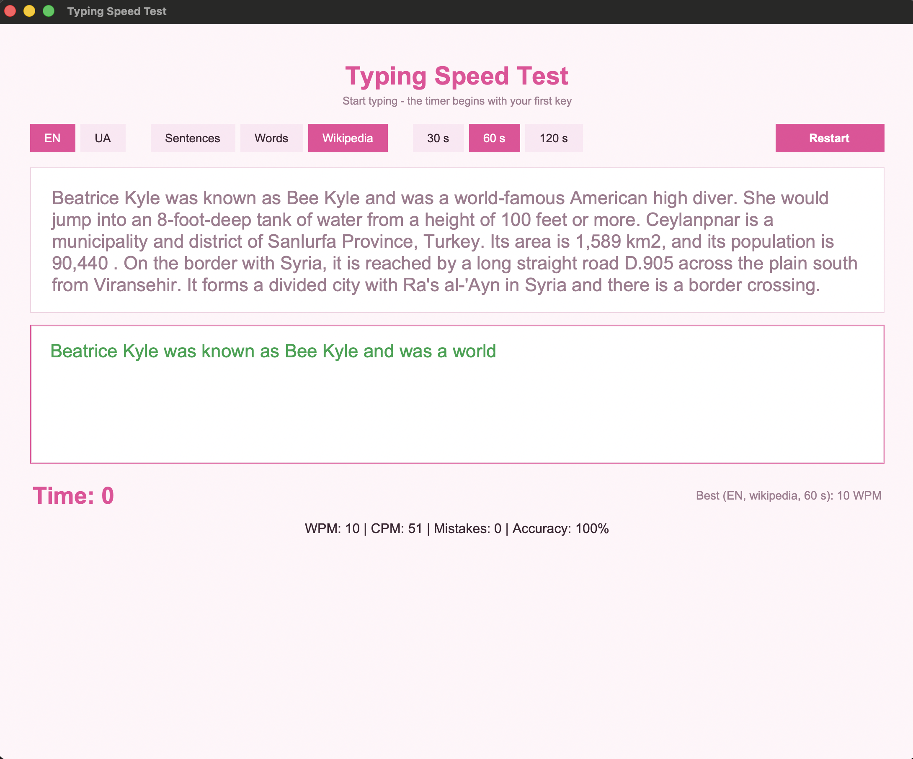

# Typing Speed Test

A desktop app that measures how fast you type. Built with **Tkinter**, using only the Python standard library.



Part of my *100 Days of Code: The Complete Python Pro Bootcamp* projects (Day 86).

## Features

- **Timer starts on your first key press**, so you never race the clock before you are ready
- **Live feedback**: correct characters turn green, mistakes turn red
- **Results**: WPM, CPM, mistakes and accuracy, with a summary when the test ends
- **Three text modes**
  - *Sentences*: a mix of random built-in sentences
  - *Words*: random common words from a word list
  - *Wikipedia*: fresh text from random Wikipedia articles, downloaded in the background
- **Two languages**: English and Ukrainian
- **Test length**: 30, 60 or 120 seconds, with more text for longer tests
- **High scores** saved per language, mode and duration
- Works offline: if Wikipedia cannot be reached, a built-in text is used instead

## Run it

```bash
python main.py
```

No packages to install. Tkinter ships with the standard Python installer. On some Linux distributions install it separately (`sudo apt install python3-tk`).

To type Ukrainian text, switch your keyboard layout to Ukrainian.

## How it works

| Value | Formula |
|---|---|
| CPM | correctly typed characters per minute |
| WPM | CPM / 5 (one "word" is five characters) |
| Accuracy | correct characters / all typed characters |

Every key release compares the typed text with the sample and colours each character. The test ends when the time runs out or the whole sample is typed. Then the input is locked and the results are shown.

The Wikipedia mode calls the public [Wikipedia REST API](https://en.wikipedia.org/api/rest_v1/) (`page/random/summary`) in a background thread, so the window never freezes. The text is cleaned to characters that are easy to type: brackets are removed, typographic dashes and quotes are replaced, and accents are dropped for English.

## Files

| File | Purpose |
|------|---------|
| `main.py` | The whole app: logic and the Tkinter interface |
| `texts.py` | Built-in sample sentences (English and Ukrainian) |
| `words_en.txt`, `words_uk.txt` | Word lists for the *Words* mode, one word per line |
| `highscore.json` | Created on the first record; not committed |

## Built with

Python 3, Tkinter / ttk, Wikipedia REST API
